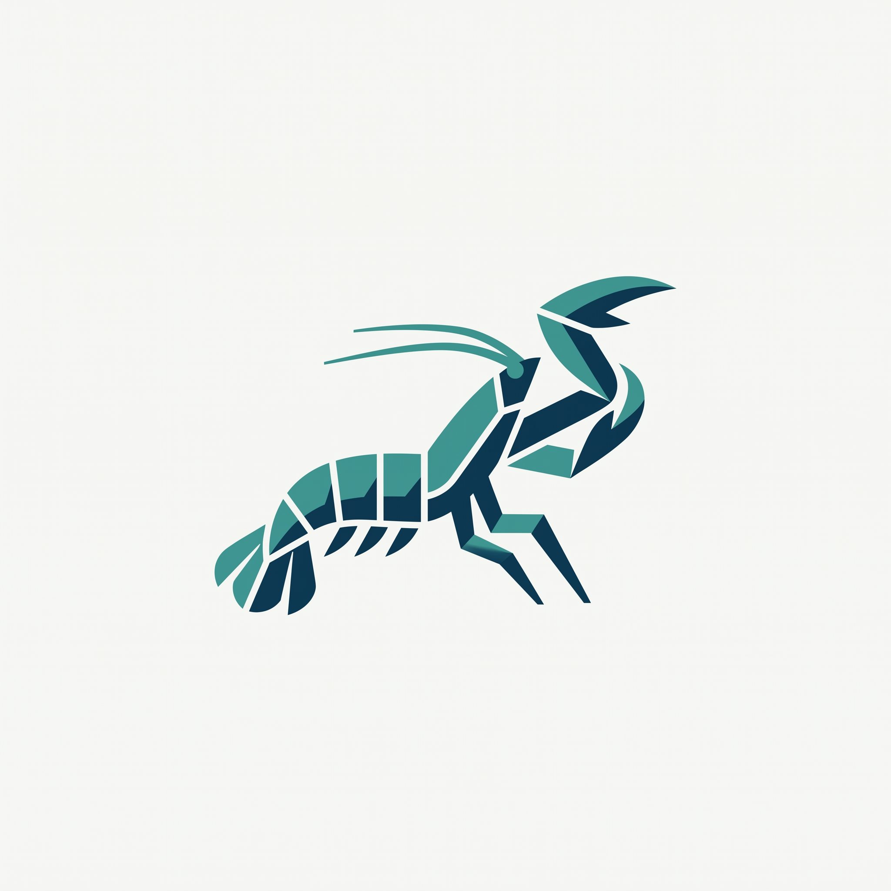

<p align="center"></p>

Stomato — a natural-gas process simulation engine, inspired by the stomatopod.

# ngdesign

Natural gas processing design: simulation → PFD → P&ID → 3D piping → isometrics, all generated from one validated model.

```
uv sync --all-groups && uv run pytest -rs
```

- Architecture and rules for contributors (human or agent): `AGENTS.md`
- Contracts between layers: `src/ngdesign/contracts/`
- Work queue: `specs/backend/`
- Reference data (ASME B36.10, B16.5, pipe classes, component constants): `data/`
- Demo target: `tests/e2e/test_slice.py`
